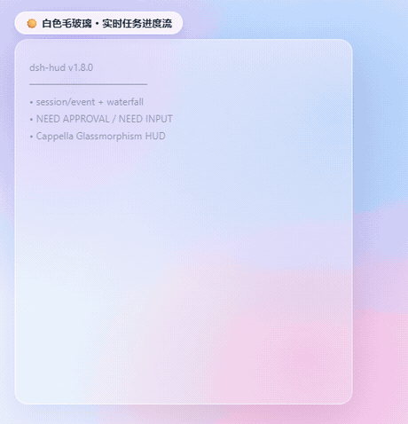

# dsh-hud · 任务通知流 HUD

[](https://github.com/nuclearmilk/dsh-hud/releases)
[](https://github.com/nuclearmilk/dsh-hud/actions/workflows/release.yml)
[](LICENSE)

为 **DeepSeek Harness (DSH)** 打造的屏幕贴边任务通知流 HUD。群唱（Cappella）风格的水润毛玻璃气泡会在屏幕边缘实时浮出，不仅汇报 `THINKING` / `WORKING` / `STEP DONE` / `COMPLETED` 与长任务 `RUNNING` 计时，更能在 **需要你批准权限、填写执行方向或确认计划** 时置顶弹出高对比脉冲强提醒，防止挂在后台时忘记处理。



---

## 状态一览

| 气泡徽章 | 触发时机 | 视觉与行为 |
| --- | --- | --- |
| `THINKING` | 新一轮对话开始（`turn/start`） | 紫色徽章 + 扫光动效，7 秒自动淡出 |
| `WORKING` | 工具调用中（`tool/call`） | 琥珀色徽章 + 扫光动效，可开启全程常驻 |
| `STEP DONE` | 单步工具返回（`tool/result`） | 青蓝色徽章，短句轻快反馈，7 秒淡出 |
| `COMPLETED` | 本轮结束（`turn/end`） | 翠绿色徽章，截取最终回复摘要展示 |
| `RUNNING` | 本轮尚未结束时的常驻状态 | 底部脉冲绿/琥珀点，实时显示 `已运行 mm:ss`（可关，默认开启） |
| `NEED APPROVAL` | 需要批准命令/提权/权限确认卡 | **珊瑚红高对比呼吸边框**，显示工具名与原因 + `已等待 mm:ss` |
| `NEED INPUT` | `ask_user_question` 等待选择或填写方向 | **琥珀橙高对比呼吸边框**，显示问题摘要（含 `timed` 超时挂起态） |
| `PLAN REVIEW` | 计划模式 `exit_plan_mode` 等待确认 | **靛紫色高对比呼吸边框**，提示审阅执行计划 |

> 进入 `NEED APPROVAL` / `NEED INPUT` / `PLAN REVIEW` 等待人工处理状态时，HUD 会**自动暂时隐藏 `RUNNING` 气泡**并**暂停 45 分钟静默自动收起**，避免“还在运行”的错觉；多会话同时卡住等待时还会显示 `另有 N 项待处理`。

---

## 特性

- 🚨 **等待批准 / 填写方向常驻强提醒（v1.8.0）**：
  - 宿主侧通过 Cordis waterfall（`approval/request`、`user-questions/request`）透明观测 + `session/event` 双通道去重，零侵入捕获权限审批、自由提问与计划确认。
  - 独立置顶槽位，不会被普通进度气泡或 `MAX_BUBBLES` 顶掉；定时提问（`timed`）超时转入挂起态后仍持续提醒，直到你提交回复。
  - 支持「**等待操作时播放轻柔提示音**」（Web Audio 合成，零外部依赖，设置页可开关）。
- 🫧 **Cappella 水润毛玻璃 & 明暗双主题**：高斯模糊 + 内发光边框，☀️ 纯净白色毛玻璃 / 🌙 深邃暗色磨砂全量适配高对比配色。
- 🎚️ **无级透明度 & 自由拖拽记忆坐标**：20% ~ 100% 拖动实时生效；移动模式随手拖，支持多显示器智能边界钳位，拔掉副屏坐标不跑丢。
- 🎭 **个性化头像 & 系统字体全量检索**：莫奈渐变、纯色轮盘 / Hex 输入、本地图片居中裁剪压缩（WebP/PNG/动图 GIF）；跨平台自动检索本机已安装字体并带缓存。
- 💬 **左右分边或整齐靠右**：`allRight` 关闭时气泡左右交替弹出，模拟对话节奏。
- ⏳ **常驻「进行中」气泡 & 静默兜底**：长任务一直显示 `已运行 mm:ss`；普通进度超过设定分钟数（默认 45）无事件自动收起。
- 🔔 **设置页一键预览**：支持「**🫧 发送测试气泡**」与「**🔔 预览等待提醒**」，无需真实触发任务即可调优外观。
- 🛡️ **工业级安全与进程隔离**：Electron 窗口启用 `contextIsolation: true` + `sandbox: true` + `nodeIntegration: false`，仅通过受控 `preload.js` 桥接；本地控制端口仅监听 `127.0.0.1:52399`，启用随机 `X-DSH-HUD-Token` 鉴权、回环与 `dsh-app://` Origin 白名单、2 MB 请求体限额与配置字段白名单。

---

## 安装

### 桌面版（Windows / macOS / Linux App，推荐）

桌面版的 `desktop` profile 由 Electron 应用独占，命令行无法管理它，**请用界面安装**：

1. 打开 DSH → **设置** → **插件** → **添加插件**
2. 安装方式选 **Git**，把下面这一整行粘进输入框：

   ```text
   https://github.com/nuclearmilk/dsh-hud
   ```

3. 点 **安装**，等进度跑完
4. **重启 DSH**（气泡是独立 Electron 进程，由宿主插件在启动时拉起）
5. 设置侧栏出现 **「任务通知流HUD」** 页 = 装好了

也可以前往 [Releases](https://github.com/nuclearmilk/dsh-hud/releases) 直接粘贴最新版 `dsh-hud-<版本>.tgz` 下载链接安装，或用 tag / commit 锁定版本：

```text
https://github.com/nuclearmilk/dsh-hud#v1.8.0
```

### 命令行（仅非 `desktop` profile，例如 `tui`）

```sh
dsh plugin --profile tui add https://github.com/nuclearmilk/dsh-hud
```

> 对 `desktop` 执行 `dsh plugin` 会报错 `profile "desktop" is managed exclusively by the Electron application`，属设计如此。

### 本地开发联调（link 方式）

```sh
dsh plugin --profile tui add link:/path/to/dsh-hud
```

---

## 更新与卸载

| 操作 | 做法 |
| --- | --- |
| 更新（Git / link 安装） | 界面里先卸载再装一次；link 方式直接 `git pull` 后重启 DSH |
| 更新（Releases `.tgz`） | 用新版 `.tgz` 链接重新添加或卸载后重装 |
| 卸载 | 设置 → 插件 → 选中 `dsh-hud` → 卸载 → 重启 DSH |

---

## 常见排查

| 现象 | 原因 | 处理 |
| --- | --- | --- |
| 安装时提示 spec 无效 | 输入框里留了模板文本 | 只保留 `https://github.com/nuclearmilk/dsh-hud` |
| 升级后界面还是旧样子 | 上一轮留下的气泡进程占着 52399 | 1.4.2+ 会自动请求 `/api/quit`；若仍占用，手动结束 `electron.exe` 后重启 DSH |
| 设置页提示未连接但屏幕有气泡 | 控制端口源白名单未匹配或新窗口尚未就绪 | 升级到 v1.8.0+（已放行 `dsh-app://` 桌面源）并点「重试连接」 |
| 设置里有页面，但屏幕上没有气泡 | 宿主非 Electron 或未获取到 Electron 运行时 | 见下一节运行时获取说明；查看设置页橙色提示 |

---

## 运行方式：零外部插件依赖

桌面版装完即可用，**不需要预先安装 Electron 或其他配套插件**。缺少运行时会自动下载一份共享运行时到 `~/.dsh/electron/`（首次约 138 MB，之后复用）：

- **并行测速选源**：GitHub / npmmirror / 华为云并行测速（各取 512 KB），自动选择最快源并遵循 `HTTP_PROXY` / `HTTPS_PROXY` / `NO_PROXY`。
- **断点续传 + SHA-256 校验**：`.zip.part` 断线续传，下载后自动校验 `SHASUMS256.txt` 并解压；`.download.lock` 带过期与死 PID 自愈。
- **自定义路径与镜像**：支持 `DSH_HUD_ELECTRON`、`DSH_HUD_ELECTRON_DIR`、`DSH_HUD_ELECTRON_VERSION`、`DSH_HUD_ELECTRON_MIRROR`。

> 为什么单独拉起 Electron 窗口：DSH 桌面宿主以 `ELECTRON_RUN_AS_NODE=1` 模式加载插件，`require('electron')` 无法取得 `BrowserWindow`，因此需要一份独立的 Electron 运行时承载透明置顶气泡窗。

---

## 启动性能

- **模块导入 `lib/index.js`**：约 60 ms（冷）/ 2 ms（热）
- **`apply()` 同步部分**：约 2.0 ms
- **气泡窗口默认延迟 3 秒拉起**（`DSH_HUD_SPAWN_DELAY_MS` 可调为 `0`），不与 DSH 主界面抢启动 IO；启动耗时探针日志位于 `~/.dsh/dsh-hud/boot.log`。

---

## 数据与隐私

- 配置统一保存在 `<appData>/dsh-hud/dsh-hud-config.json`，不写入插件包目录；首次升级自动迁移旧路径配置。
- 不联网上报任何聊天或行为数据：全部事件仅在本机进程间通过 `127.0.0.1` 流转。
- 本地控制接口监听 `127.0.0.1:52399`，启用本机回环与 `dsh-app://` 源白名单、随机 `X-DSH-HUD-Token` 鉴权、2 MB 请求体上限及字段白名单校验。

---

## 环境变量

| 变量 | 默认值 | 说明 |
| --- | --- | --- |
| `DSH_HUD_SPAWN_DELAY_MS` | `3000` | 启动后延迟拉起气泡窗口的毫秒数（`0` = 立即） |
| `DSH_HUD_CONTROL_PORT` | `52399` | 本地控制接口端口 |
| `DSH_HUD_CONTROL_TOKEN` | 随机生成 | 覆盖本地控制接口鉴权 Token |
| `DSH_HUD_ELECTRON` | 自动解析 | 显式指定 Electron 可执行文件路径 |
| `DSH_HUD_ELECTRON_DIR` | `~/.dsh/electron` | 共享 Electron 运行时存放目录 |
| `DSH_HUD_ELECTRON_VERSION` | `43.3.0` | 自动下载的 Electron 版本 |
| `DSH_HUD_ELECTRON_MIRROR` | 未设置 | 置顶自定义镜像基址（支持 `http://` / `https://`） |
| `HTTP_PROXY` / `HTTPS_PROXY` / `NO_PROXY` | 系统环境 | 自动下载运行时与测速时遵循的代理配置 |

---

## 架构

| 层 | 文件 | 职责 |
| --- | --- | --- |
| 宿主插件 | `lib/index.js` | 声明 `dsh.bundle`，监听 `session/event` 与 `approval/request` / `user-questions/request` waterfall，暴露 `/dsh-hud/state` 与 `/dsh-hud/control-info` |
| 共享核心 | `lib/hud-core.cjs` | 配置校验与迁移、多屏坐标钳位、跨平台字体检索、本地控制服务、多会话事件队列与等待状态机 |
| 进程内窗口 | `lib/inprocess.js` | 当宿主运行在 Electron 主进程内时直接建窗；桌面版 Node 模式下走独立窗口路径 |
| 配置前端 | `lib/client.js` | 注入 `settings.section`，支持实时设置、头像压缩上传、测试/等待预览与自动重连 |
| 运行时获取 | `lib/runtime-fetch.js` | 自动测速下载 Electron 到 `~/.dsh/electron/`（代理 + 断点续传 + SHA-256 校验） |
| 独立窗口 | `runtime/main.js` · `runtime/preload.js` · `runtime/index.html` | 独立透明置顶窗口，安全隔离桥接、自由拖拽与气泡/脉冲强提醒渲染 |
| 单元测试 | `test/hud-core.test.mjs` · `test/runtime-fetch.test.mjs` | 基于 Node 内置 `node:test` 的 20 项核心逻辑、等待态去重与下载器测试 |
| 云端发布 | `.github/workflows/release.yml` | 推送 `main` 自动跑测，推送 `v*` 标签自动 `npm pack` 并发布 Release |

---

## 开发与测试

```sh
npm test
```

## 协议

MIT
